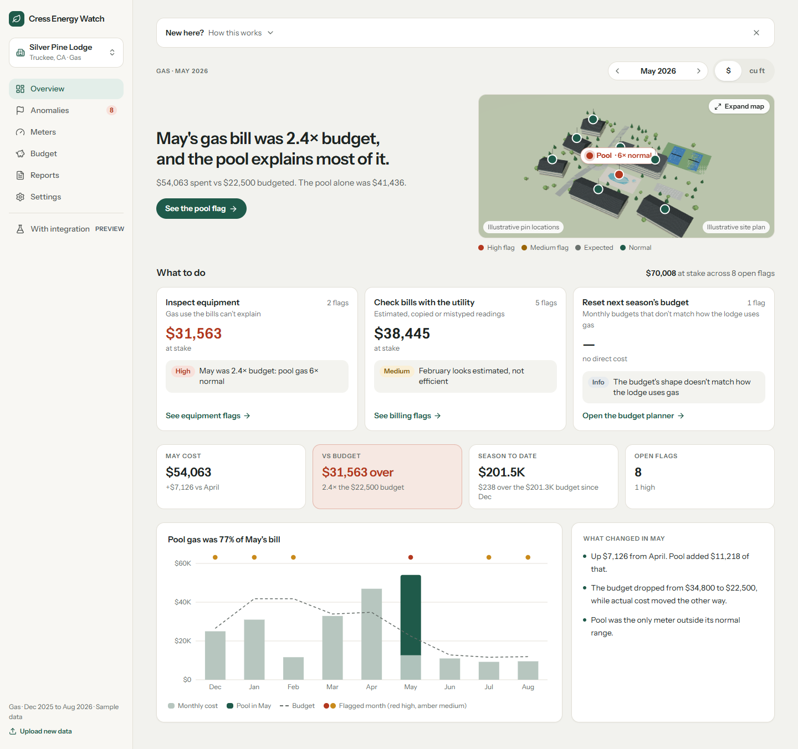
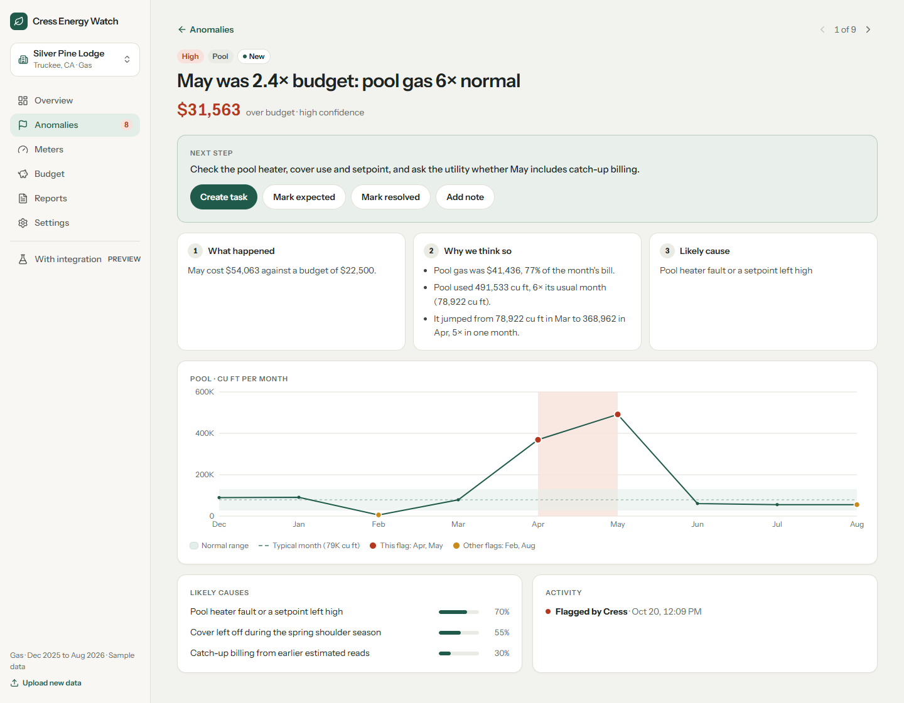

# Cress Energy Watch

**Know why the gas bill moved before the board asks.** A utility-cost watchdog for resort condo hotels and HOAs: upload the monthly gas spreadsheet (or the bill PDFs), and it flags what's wrong, explains each flag in plain English, puts a dollar figure on it, and tells the property manager what to do next.

> **All data is fictional.** "Silver Pine Lodge", its site plan and every number in the sample sheet are invented (`scripts/make-site.mjs`, `scripts/make-sample.mjs`). The only real input is public heating-degree-day weather data for the region (Open-Meteo).



---

## The problem

At a typical resort property, gas tracking is a hand-built spreadsheet: one row per meter per month, cost = cu ft × rate, compared against a budget. Costs swing month to month and nobody knows why until well after the fact. Was it the weather? A failing pool heater? An estimated meter read that will "catch up" next month? A typo in the sheet?

Cress answers that **from the bills alone**, with no site visit, sensors or system integrations.

## What it catches

The detection engine (`src/engine/signals.ts`) is deterministic, weather-aware and fully unit-tested. Every threshold lives in one table (`T`), so each flag can be explained.

| Flag | How it's detected |
|---|---|
| **Equipment spike** | Robust z-score (median / MAD) above 3.5 *and* at least 2.5× the prior month, so it's immune to the outliers it's hunting |
| **Estimated reads + catch-up** | 3+ meters reading below 25% of their neighbors in a heating month, followed by a catch-up of 1.5× or more |
| **Copied month** | 3+ meters with exactly the same reading as last month |
| **Entry error** | The sheet's two cost columns disagree, and swapping one meter's value for its reading from another month closes the gap to within $1 |
| **Cost mismatch** | Cost columns disagree and no single-meter fix explains it, so check the bill |
| **Over budget** | More than 1.5× budget, attributed to the meter that drove it |
| **Dominant meter** | One meter is more than 30% of season spend |
| **Budget shape** | The budget itself is wrong: many months off by over 15%, copy-pasted months, or budget falling while usage rises |
| **Seasonal shutdown** | Recognized as *expected*, not flagged as an outage |

Each flag becomes a card: what happened, why we think so, the likely causes with confidence, the dollars at stake, and one next step ("Check the pool heater, cover use and setpoint, and ask the utility whether May includes catch-up billing").



## Product decisions

- **Rules find, the LLM only reads.** Claude is used for one job: turning messy uploads (any spreadsheet layout, or bill PDFs) into a strict schema (`server/normalize.ts`), constrained to a JSON schema, with "never invent readings" in the instructions. All detection is deterministic and explainable.
- **Dollars first.** Every flag carries an at-stake figure, and the overview groups them into *Inspect equipment / Check bills with the utility / Reset next season's budget*, the three jobs a property manager can actually act on.
- **Honest about levels.** Level 1 (bills only) works today. Level 2 (connected meters and building controls: short-cycling boilers, after-hours runtime) is shown as a clearly labeled preview, never as live.
- **Built for the person who pays the bill.** Plain English, no jargon, mobile layout down to 390px, and a printable monthly report for the board.

## Stack

React + TypeScript (Vite) · Tailwind · Three.js 3D site map with live meter pins · Vercel serverless function for AI normalization (Claude) · basic-auth middleware · Vitest (90 tests: the signal rules, stats, budget planner, parsing, normalization, auth) · Playwright (flows + a screenshot sweep at 1440px and 390px that fails on horizontal overflow)

## Run it

```bash
npm install
npm run dev          # http://localhost:5173, loads the sample sheet
npm run check        # typecheck + lint + tests + build
npm run e2e          # Playwright flows and screenshots
```

To try AI upload of your own spreadsheets or PDFs, copy `.env.example` to `.env.local` and set `ANTHROPIC_API_KEY`.

Regenerate the fictional data with `npm run data:site` and `npm run data:sample`.
